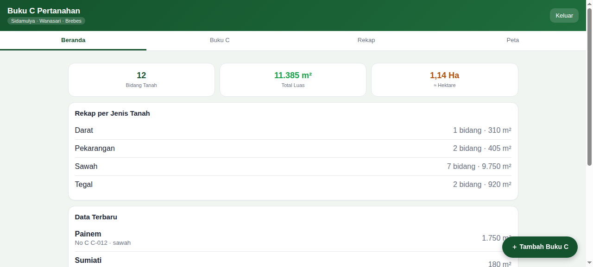
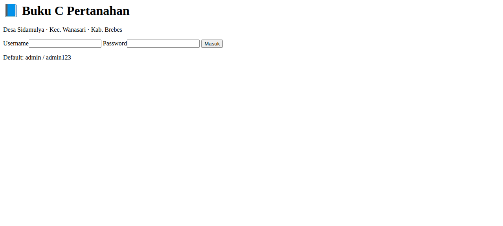
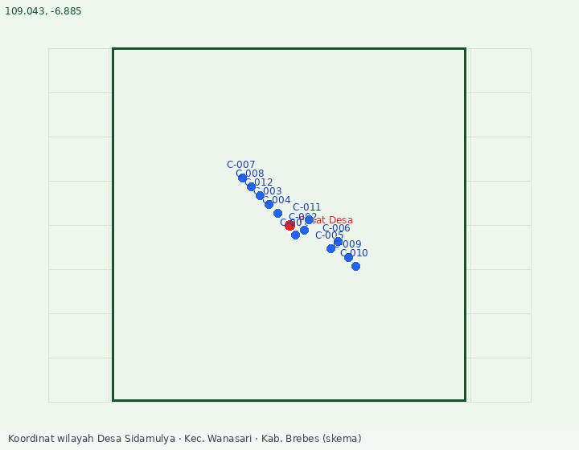
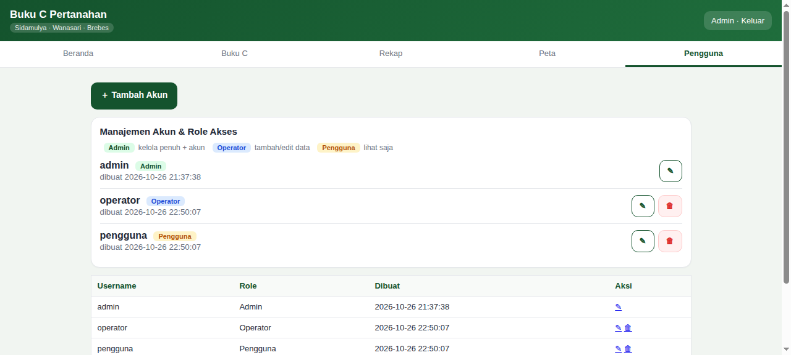
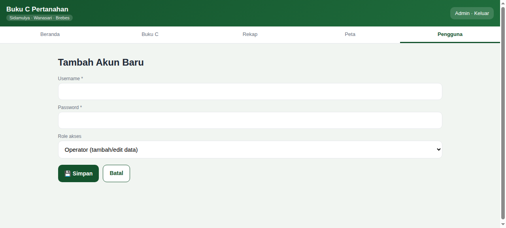
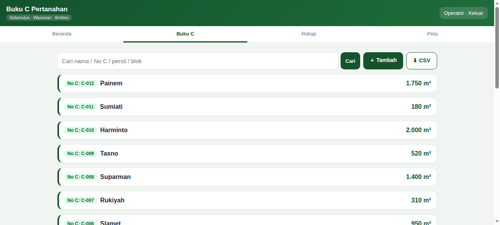
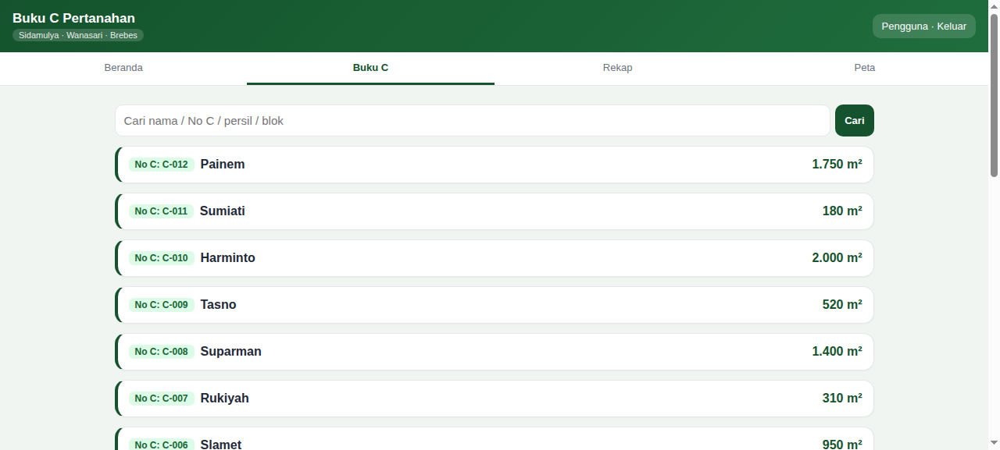

# 📘 Buku C Pertanahan — Desa Sidamulya

Aplikasi **Buku C (Letter C) pertanahan** untuk Desa **Sidamulya, Kec. Wanasari, Kab. Brebes, Jawa Tengah**. Mencatat bidang tanah (pemilik, nomor C, persil, blok/dusun, jenis, luas, batas-batas, titik koordinat), rekap per jenis & blok, skema peta titik koordinat, dan ekspor CSV.

> Koordinat wilayah: pusat desa **-6.90535, 109.02330** (bbox lat -6.925…-6.885, lon 109.003…109.043).

## Fitur
- **Beranda** — ringkasan jumlah bidang, total luas (m² & Ha), rekap jenis, data terbaru.
- **Buku C** — daftar kartu (mobile) + tabel (desktop), cari, tambah, edit, hapus.
- **Rekap** — per jenis tanah & per blok/dusun.
- **Peta** — skema titik koordinat wilayah (canvas) + titik bidang yang ber-lat/lon.
- **Mutasi & Verifikasi (STAGE 3)** — alamat per bidang (`Ajuan → AKTIF/Batal`), verifikasi & approval Kepala Desa, ajukan mutasi (jual/waris/hibah/pecah) dengan riwayat + persetujuan; bidang AKTIF terkunci (edit/hapus hanya untuk admin).
- **Ekspor CSV** semua data.
- **Role akses** — admin / operator / pengguna (lihat tabel di bawah).

## Role Akses
| Role | Beranda | Buku C | Tambah/Edit | Hapus | Rekap/Peta | Mutasi | Verifikasi (Kades) | Ekspor | Kelola Akun |
|------|:------:|:------:|:-----------:|:-----:|:----------:|:------:|:------------------:|:------:|:-----------:|
| **Admin** | ✅ | ✅ | ✅ | ✅ | ✅ | ✅ | ✅ | ✅ | ✅ |
| **Operator** | ✅ | ✅ | ✅ | ❌ | ✅ | ✅ | ❌ | ✅ | ❌ |
| **Pengguna** | ✅ | ✅ | ❌ | ❌ | ✅ | ❌ | ❌ | ❌ | ❌ |

Akun contoh (ubah segera): `admin/admin123`, `operator/operator123`, `pengguna/pengguna123`.

## Stack
PHP native + SQLite. Tanpa framework, tanpa composer, tanpa MySQL. Bisa jalan di shared hosting PHP 8.

## Struktur
```
app/
├── index.php      # router
├── install.php    # setup DB + admin, HAPUS setelah dipakai
├── seeder.php     # data contoh (idempotent)
├── core/          # Database, Auth, Helper
├── controllers/
├── views/         # layout.php + body halaman
├── assets/        # app.css, app.js
└── db/            # SQLite (tidak dikomit)
docs/              # screenshot + skema peta
```

## Cara Pasang
1. Upload folder `app/` ke hosting (atau buka via `php -S localhost:8898` di terminal).
2. Akses `install.php` → buat DB + akun admin. **Hapus install.php** setelah itu.
3. (Opsional) jalankan `php seeder.php` untuk 12 baris data contoh.
4. Login: **admin / admin123** — segera ganti password.

### Coba langsung dari GitHub (Codespaces)
Repo ini punya `.devcontainer` — klik **Code → Codespaces → Create codespace on main**. Setelah siap, browser otomatis terbuka ke port 8898; login `admin/admin123`. Tanpa setup apa pun, langsung bisa klik-klik.

### Cek kesehatan
`bash tests/run_checks.sh 8898` — lint PHP, cek DB, smoke test login + route.

## Keamanan
- PDO prepared statement di semua query.
- Password di-hash (`password_hash`).
- CSRF token per form, dicek `hash_equals`.
- `.htaccess` memblokir akses folder `core/` dan `db/`.

## Verifikasi yang sudah dilakukan
- ✅ `php -l` semua file
- ✅ Router: login/route authed 200, redirect tamu → /login
- ✅ Login POST + session regenerate
- ✅ CRUD tambah tersimpan (dicek di DB), hapus, edit
- ✅ CSRF: POST tanpa token → HTTP 419
- ✅ Data contoh: 12 bidang, 11.385 m², koordinat benar
- ⚠️ Belum diuji di hosting target (baru `php -S` lokal)

## Screenshot







### Role akses




